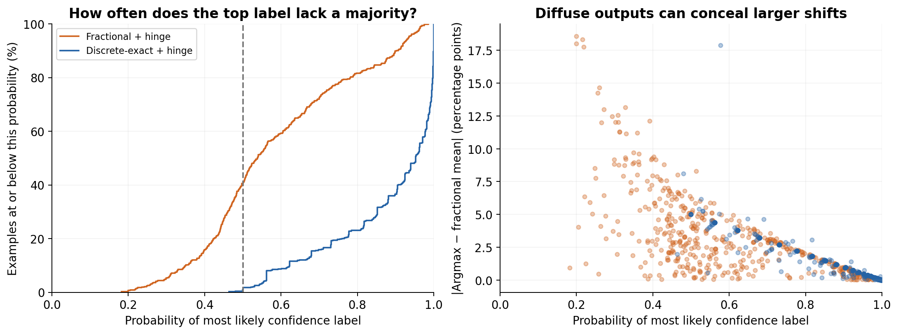
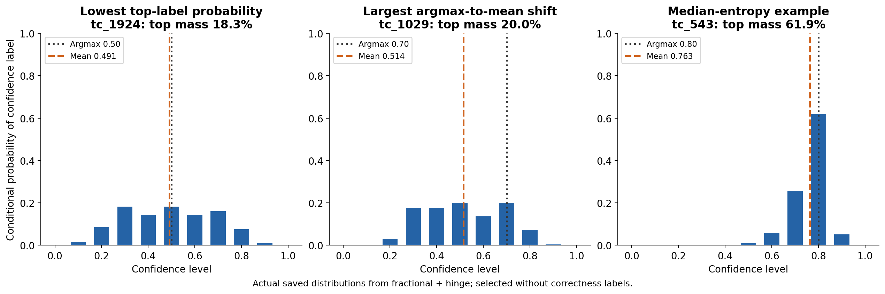

# What argmax discards in the saved confidence distributions

We can measure this directly from the saved probabilities of all eleven complete confidence strings. The main comparison uses the two hinge-trained checkpoints on 474 held-out answers each. **A low top-label probability means argmax hides substantial probability mass on other confidence levels.** Whether that lost detail matters for correctness is a separate, testable question.

## Measurements

For normalized probabilities pi[k], levels c[k] = k/10, and k* = argmax pi[k]:

```text
Top-label probability:       m = pi[k*]
Mass outside the top label:  1 - m
Entropy (millinats):         -1,000 sum_k pi[k] ln pi[k]
Effective label count:      exp(entropy / 1,000)
Argmax confidence:          a = c[k*]
Fractional confidence:      mu = sum_k pi[k] c[k]
Spread:                     sqrt(sum_k pi[k] (c[k] - mu)^2)
Mean displacement:          sum_k pi[k] |c[k] - a|
```

The mass outside the top label is also the total variation distance between pi and a point mass at argmax. Entropy describes variability in the emitted label, while spread and displacement account for how far apart the confidence levels are. The entropy here is **not** a measured mutual-information loss about true correctness.

Top-label probability is conditional on one of the eleven canonical strings being emitted. We normalize their saved sequence log probabilities with log-sum-exp and report valid mass separately. These are complete strings including EOS, not individual tokenizer tokens.

| Checkpoint | Mean top probability | Top < 50% | Mass outside top | Entropy (mnat) | Mean absolute shift (pp) | Mean spread (pp) | Valid mass |
|---|---:|---:|---:|---:|---:|---:|---:|
| Fractional + hinge | 58.4% | 40.5% | 41.6% | 1000.8 | 3.36 | 7.59 | 99.9916% |
| Discrete-exact + hinge | 88.2% | 1.7% | 11.8% | 283.6 | 1.16 | 2.49 | 99.9999% |

Here pp means percentage points on the 0–100% correctness-confidence scale.



The fractional-trained model retains substantially more variation among confidence labels. This is consistent with its objective caring about the mean, while the discrete objective rewards committing to a grid level. The figure describes these checkpoints; it does not isolate a causal training effect across repeated runs.

## Does discarding the distribution hurt held-out predictions?

For each answer we compute NLL(argmax) − NLL(fractional), with the same .001 clipping. Positive values favor the fractional mean. All values below are **millinats per answer**. The 95% intervals use 5,000 paired bootstrap resamples of examples with a fixed seed.

| Checkpoint | Top-probability group | n | Mean absolute shift (pp) | NLL difference (mnat) | 95% interval |
|---|---|---:|---:|---:|---|
| Fractional + hinge | All | 474 | 3.36 | 15.91 | [4.92, 27.37] |
| Fractional + hinge | 0%–50% | 192 | 5.33 | 28.92 | [6.02, 53.55] |
| Fractional + hinge | 50%–75% | 176 | 2.71 | 9.08 | [-5.09, 24.82] |
| Fractional + hinge | 75%–100% | 106 | 0.88 | 3.67 | [-2.64, 11.01] |
| Discrete-exact + hinge | All | 474 | 1.16 | 3.63 | [-2.03, 10.63] |
| Discrete-exact + hinge | 0%–50% | 8 | 5.01 | -18.13 | [-80.28, 37.31] |
| Discrete-exact + hinge | 50%–75% | 85 | 3.74 | -2.70 | [-21.09, 15.87] |
| Discrete-exact + hinge | 75%–100% | 381 | 0.50 | 5.50 | [0.31, 13.14] |

Groups are lower-inclusive, upper-exclusive, except the last includes 100%. These exploratory intervals assume independent examples, condition on the trained checkpoint, and do not adjust for multiple comparisons or capture training-seed variation. Small groups can be especially unstable.

## Actual example distributions



Examples are chosen using only distribution diagnostics: lowest top-label probability, largest argmax-to-mean shift, and median entropy. The first two deliberately show extremes; the third provides a central comparison. IDs and all eleven probabilities are in the JSON output.

## What this does and does not establish

Your proposed diagnostic detects real information discarded by argmax. It is useful to measure top-label mass **together with numerical spread and argmax-to-mean shift**. For example, probabilities (.25, .50, .25) on levels (.5, .6, .7) have only 50% mass on the top label, but both argmax and mean equal .6. There is spread, yet switching between these two scalar readouts changes no predicted correctness probability.

A distribution over verbal confidence reports is also not automatically a calibrated posterior over the true probability of correctness. Language variation and the training objective can create spread. Fractional training constrains the mean and leaves many different shapes equally good. Consequently, high entropy alone does not prove useful epistemic uncertainty. The paired held-out NLL comparison tests the practical benefit of preserving the mean. The mean itself still discards the distribution’s shape.

## All saved checkpoints

These are descriptive summaries, not matched comparisons across different runs. In particular, the no-hinge fractional pilot has low valid mass: a diffuse distribution conditional on rare valid outputs can be misleading without that column.

| Prediction file | n | Mean top probability | Top < 50% | Entropy (mnat) | Mean shift (pp) | Valid mass |
|---|---:|---:|---:|---:|---:|---:|
| `runs/hinge-20261001T023959Z/discrete-exact-s1-eval/predictions.jsonl` | 474 | 88.2% | 1.7% | 283.6 | 1.16 | 100.000% |
| `runs/hinge-20261001T023959Z/fractional-s1-eval/predictions.jsonl` | 474 | 58.4% | 40.5% | 1000.8 | 3.36 | 99.992% |
| `runs/paper-ppo-20261001T051018Z/base-eval/predictions.jsonl` | 474 | 92.6% | 2.1% | 194.8 | 1.07 | 100.002% |
| `runs/pilot-20261001T002945Z/base-eval/predictions.jsonl` | 474 | 94.2% | 3.6% | 147.2 | 0.75 | 99.584% |
| `runs/pilot-20261001T002945Z/discrete-exact-s1-eval/predictions.jsonl` | 474 | 88.7% | 2.5% | 264.0 | 1.05 | 99.894% |
| `runs/pilot-20261001T002945Z/discrete-ppo-s1-eval/predictions.jsonl` | 474 | 92.9% | 3.2% | 179.4 | 0.85 | 99.632% |
| `runs/pilot-20261001T002945Z/fractional-s1-eval/predictions.jsonl` | 474 | 68.9% | 24.3% | 778.0 | 3.21 | 2.582% |
| `runs/smoke-20260930T222803Z/base-eval/predictions.jsonl` | 115 | 94.1% | 4.3% | 155.9 | 0.77 | 99.542% |
| `runs/smoke-20260930T222803Z/discrete-exact-eval/predictions.jsonl` | 115 | 87.5% | 4.3% | 301.3 | 1.27 | 99.321% |
| `runs/smoke-20260930T222803Z/discrete-ppo-eval/predictions.jsonl` | 115 | 93.2% | 5.2% | 173.2 | 0.79 | 99.577% |
| `runs/smoke-20260930T222803Z/fractional-eval/predictions.jsonl` | 115 | 87.0% | 6.1% | 316.2 | 1.28 | 99.330% |

## Reproduce

```bash
python scripts/analyze_argmax_distribution.py
```

The script checks that reconstructed means, argmax values, and valid mass match saved predictions. Outputs: [summary JSON](argmax-distribution-results.json), [per-example CSV](argmax-distribution-rows.csv), PNG/SVG plots, and this [offline HTML report](argmax-distribution.html). No new model calls or training are needed.
