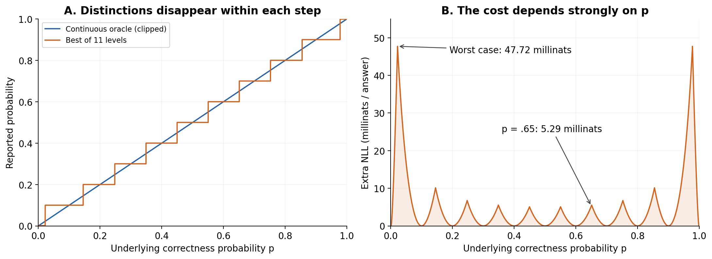
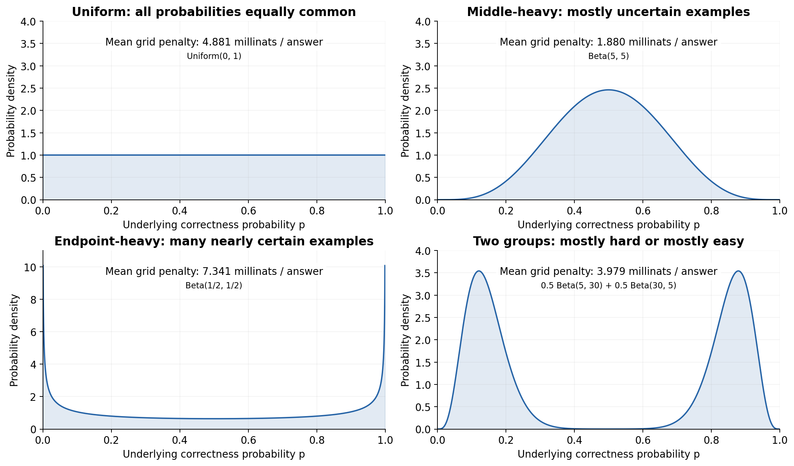
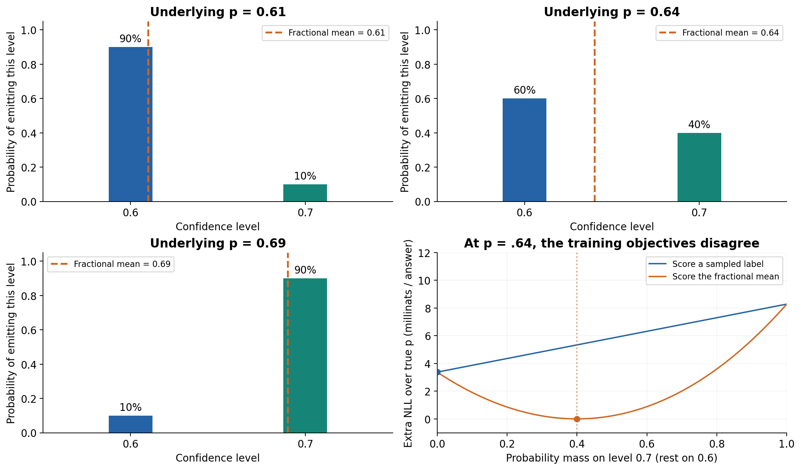
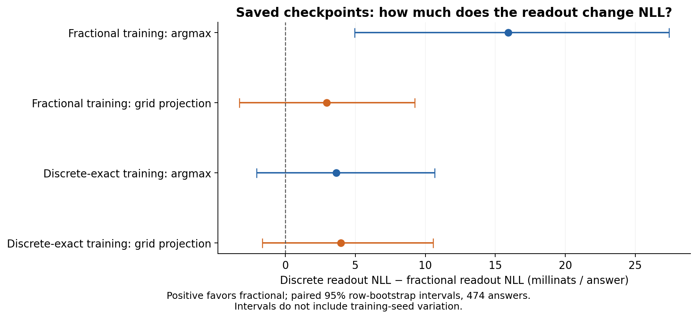

# Eleven confidence levels impose a ceiling that fractional readouts can escape

An emitted confidence label carries at most **1,000 ln(11) = 2,397.895 millinats
(3.459432 bits)** about underlying confidence. This is a communication bound,
not a 2,397.895-millinat penalty in prediction NLL. The NLL cost depends on where the true
probabilities lie and how labels are decoded. There is no universal positive NLL
penalty: the true probabilities could already lie on the grid.

This repository uses eleven complete strings `0` through `10`, not necessarily
eleven tokenizer tokens (`10` uses two tokens for the current model). Its existing
fractional objective already avoids the discrete readout restriction by reading
the distribution over all eleven strings.

The argument for fractional training is therefore specific: **even a perfectly
trained system restricted to these eleven numerical reports cannot express an
intermediate correctness probability exactly.** Once estimation and optimization
errors become small enough, the grid itself limits performance. A fractional
readout removes that particular limit. It creates room for improvement; it does
not establish that more training will use that room.



*Figure 1. Both oracles know the true correctness probability. Their only
difference is the allowed report. The staircase selects the grid level minimizing
expected log loss; it is not ordinary rounding at the endpoints. Scores use the
repository's .001 clipping. The right panel is a representation penalty, before
any finite-data or optimization error is introduced.*

**Units:** 1 nat = 1,000 millinats (mnat). Numerical information and NLL values
below use millinats. The natural-log formulas retain their conventional nat units;
multiply their values by 1,000 to obtain the displayed millinats.

## Communication and predictive loss are different quantities

Let P be the underlying probability of correctness given the available information,
Y the binary correctness outcome, and K the single emitted confidence label.
Assume Y | P is Bernoulli(P), and K is computed from P, possibly with independent
randomness. For an eleven-valued K,

    I(P; K) <= H(K) <= ln(11).

For a deterministic encoder, I(P; K) = H(K); the capacity is attained only with
equally frequent labels. This applies to the confidence channel alone. Extra text,
repeated draws, or access to logits provides a different channel. Conditional on
any shared context C, the corresponding bound I(P; K | C) <= ln(11) still holds.
See the [Stanford information theory notes](https://web.stanford.edu/~kedart/ee376a_winter1617/Lecture_3.pdf)
for the finite-alphabet entropy bound.

If a decoder can assign each bin its calibrated value m(K) = E[P | K], then its
minimum expected log loss is H(Y | K), whereas knowing P gives H(Y | P). Thus

    H(Y | K) - H(Y | P)
      = E[ KL(Bern(P) || Bern(m(K))) ]
      = I(Y; P | K).

Multiplying this expression by 1,000 gives predictive information lost in
millinats per answer. It is distribution-dependent and at most 693.147 millinats,
since Y is binary. Reporting a
fixed grid value q(K) instead adds a calibration cost:

    E[KL(Bern(P) || Bern(q(K)))]
      = I(Y; P | K) + E[KL(Bern(m(K)) || Bern(q(K)))].

These statements use ordinary, unclipped log loss with appropriate endpoint
limits. They do not subtract differential entropy from ln(11); continuous
confidence has no distribution-free finite amount of information.

For a concrete distinction, suppose half the examples have true confidence .61
and half have .64. Under the log-loss-optimal fixed-grid encoder, both produce
the .6 label. This erases all 693.147 millinats identifying which confidence type occurred.
Nevertheless, the best recalibrated decoder reports .625, losing only about
0.480 millinats/answer in predictive NLL. Reporting the prescribed value .6 instead
loses 1.792 millinats/answer. Losing information about the confidence type is not
the same as losing that many millinats of information about correctness. A different
encoder could preserve the two types by assigning different labels, but would
then pay for reporting a suboptimal grid value on some examples.

## The relevant grid penalty in NLL

For a true probability p and reported probability q,

    L(p,q) = -p ln(q) - (1-p) ln(1-q)
    L(p,q) - h(p) = p ln(p/q) + (1-p) ln((1-p)/(1-q)).

This is Bernoulli KL divergence. Log score and its associated KL divergence are
described in [Gneiting and Raftery (2007)](https://sites.stat.washington.edu/people/raftery/Research/PDF/Gneiting2007jasa.pdf).
For a fixed grid Q, the ideal grid-only forecaster has excess loss

    D_Q = E_P[ min_{q in Q} KL(Bern(P) || Bern(q)) ].

Consequently its expected NLL is at least E[h(P)] + D_Q. This is the population
oracle floor for that representation, not a floor one can calculate from binary
labels alone. Calibration, estimation error, and imperfect training add other
loss. A finite empirical test score can fluctuate below its population expectation.

The floor also holds for a randomized emitter. For every fixed p, its expected
loss is a weighted average of grid losses:

    sum_k pi[k] L(p,q_k) >= min_k L(p,q_k).

Averaging over p proves that neither randomization nor additional training can
lower the population NLL below this oracle grid floor **when the scored output
is one grid-valued report**. The gap is strictly positive if there is positive
probability of off-grid p in the unclipped interior. It vanishes for a population
supported entirely on grid points. This is a statement about this fixed numerical
grid, not the optimal placement of eleven freely chosen representatives.

The log-loss-optimal switch between adjacent positive levels a < b is

    t(a,b) = ln((1-a)/(1-b)) / [ln(b/a) + ln((1-a)/(1-b))].

For .6 and .7, t = .6511107902. Hence .61 and .69 are distinguishable as .6 and .7;
**.61 and .64** are a better example of two values mapped to the same label.
The model is not explicitly programmed to round: these are oracle choices under
expected logarithmic reward, without other optimization constraints.

| True p | Best grid q | Excess NLL, millinats/answer |
|---:|---:|---:|
| .61 | .6 | 0.208929 |
| .64 | .6 | 3.374868 |
| .65 | .6 | 5.291773 |
| .69 | .7 | 0.236616 |

Locally, KL(Bern(p) || Bern(p+e)) is approximately e²/[2p(1-p)].
With spacing delta and approximately uniform rounding error within an interior
bin, the average is approximately delta²/[24p(1-p)]. Near p=.65 with delta=.1,
this is 1.83 millinats/answer. The approximation fails near the endpoints.

## The repository clips scores at epsilon = .001

`core.py` clips probabilities to [.001,.999]. For NLL the effective grid is

    Q_epsilon = {.001, .1, .2, ..., .9, .999}.

The fair representation-only comparison uses the same clipping for both arms:

    d_epsilon(p) = min_q L(p,q) - L(p, clip(p)).

The accompanying script computes these oracle quantities:

* Uniform P on [0,1]: 1,000 E[d_epsilon(P)] = **4.88137 millinats/answer**.
  This is an illustrative prior, not an assumption established by the experiment.
* Worst p: 1,000 d_epsilon(p) = **47.72167 millinats/answer**, at p=.02215933 or
  p=.97784067, the transitions into the endpoint bins.
* The minimum is zero. There is **no nonzero distribution-free loss floor**.

The worst value follows by checking all adjacent-level transitions and endpoints:
within each grid region the regret is convex for p in [.001,.999], so a maximum
occurs at a region boundary. Outside this interval the endpoint grid and clipped
continuous oracle coincide. The worst-case value bounds the extra loss of the
*optimal* grid forecaster, not the NLL of an arbitrary trained model.

Clipping also means strict propriety only holds in the interior: probabilities
below .001 or above .999 cannot be distinguished by this score. Neither readout
beats that shared clipping restriction. Report raw NLL for these comparisons;
the repository's affine-scaled rewards are not themselves information units.

## Example populations: why there is no single NLL cost



*Figure 2. Each panel specifies a different hypothetical population of true
correctness probabilities P. The annotation integrates the same penalty curve
from Figure 1 against that population's density. These are illustrative
distributions, not fits to the experiment's predictions. The endpoint-heavy
density diverges at zero and one; its display stops at .001 and .999, while
integration covers the full interval.*

A population concentrated around uncertain examples weights the small central
bumps. A population containing many nearly certain examples weights the large
endpoint transitions as well as the zero-cost clipped tails. A population with
two groups can weight different parts of the grid again. The answer depends on
the full density, not simply on mean confidence or accuracy.

For an opposite limiting example, put all probability mass on the eleven grid
levels themselves. Then the grid penalty is exactly zero. If the labels are
equally frequent, their entropy is simultaneously the maximum 2,397.895 millinats. Maximum
label information and zero quantization penalty can coexist: they measure
different properties.

## Why the fractional readout escapes this restriction

The implementation computes pi[k] from normalized complete-string probabilities,
then reports p_bar = sum_k pi[k] k/10. A probability vector is not one draw from
that vector, so its mean need not lie on the grid. For example:

    .61 = .9 * .6 + .1 * .7
    .69 = .1 * .6 + .9 * .7.

These distributions can encode different means even though a single sampled
label remains grid-valued. In ideal real arithmetic every interior mean is
representable; finite precision and model capacity still apply in practice.
Accessing all eleven likelihoods is additional information and inference work.

Expected discrete reward is linear in pi, so its unconstrained population optimum
puts mass on a best-scoring grid level (or tied levels). Fractional reward instead
optimizes the mean, whose ideal clipped value equals clip(p). Thus fractional
training *can* beat the optimal discrete representation whenever true probabilities
fall between levels. It is not guaranteed to learn them or generalize better.



*Figure 3. The first three panels show complete confidence distributions with
nonzero mass only on .6 and .7 (the other nine levels have zero mass in this
idealized construction). Both .61 and .64 have the same argmax, .6, but their
fractional means differ. The lower-right panel holds the true probability at
.64 and varies the mass w on .7. Discrete expected log loss is minimized at
w=0; fractional log loss is minimized at w=.4, where the mean equals .64.*

This also explains why changing only the readout is not the full proposal.
Discrete training rewards collapse onto a grid level. Fractional training rewards
getting the mean right and can preserve a mixture. As discrete optimization
approaches its ideal unconstrained optimum, the mixture that encodes intermediate
confidence need not survive. The objectives, and not just the output formatting,
determine whether that information is retained. Regularization, shared model
parameters, and finite training can prevent either ideal optimum in practice.

## What the saved experiments support

The follow-up [argmax-versus-distribution analysis](argmax-distribution.html)
measures the probability mass and spread hidden by argmax directly. For the
fractional + hinge checkpoint, the top label averages 58.4% probability; it has
less than 50% probability on 192 of 474 examples (40.5%). On those 192 examples,
argmax differs from the mean by 5.33 percentage points on average and has 28.9
millinats/answer higher NLL (paired 95% interval [6.0, 53.5]). This supports
preserving the fractional readout for this checkpoint. Label-distribution
entropy is not automatically calibrated uncertainty about correctness.

Offline analysis of the hinge run, seed 1, on 474 fixed held-out answers.
All NLL values and intervals in this section are in **millinats per answer**:

| Training arm | Fractional NLL | Argmax NLL | Grid projection of fractional NLL |
|---|---:|---:|---:|
| fractional | 511.602 | 527.510 | 514.550 |
| discrete-exact | 537.617 | 541.251 | 541.566 |

Projection selects q minimizing KL(Bern(p_bar) || Bern(q)) without looking at the
label. It isolates converting the same scalar prediction to eleven levels more
directly than argmax, which need not be near the mean.

For the fractional-trained checkpoint, argmax minus fractional NLL is 15.908
(paired row-bootstrap 95% interval [4.938, 27.413]). Grid projection minus
fractional is only **2.948** (interval **[-3.279, 9.247]**). These intervals
describe held-out-row variation conditional on this checkpoint and assume
independent rows; they do not capture training-seed variation or checkpoint
selection. The latter difference does not yet establish a population benefit
over this grid projection, much less over every possible discrete forecaster.

Substituting model confidences for true p gives a plug-in oracle regret of
2.741 millinats/answer for the fractional arm. This is a diagnostic, **not a proven
floor**, because model confidences are not known true probabilities.



*Figure 4. Each comparison uses the same checkpoint and the same 474 answers.
The grid projection selects a level from the predicted mean without consulting
correctness labels. Only the fractional-trained checkpoint's argmax comparison
has an interval entirely above zero. This supports a readout benefit for that
comparison, not a claim to have measured the oracle representation floor.*

## Training recommendation

Run a longer **controlled comparison**, rather than assuming more steps help.
The saved hinge report shows upper-bin underconfidence after about 240 updates,
so longer training on the same 1,024-question cache could worsen generalization.
The current fractional-vs-discrete fractional-readout gap (26.0 millinats/answer) cannot be
attributed solely to quantization: both of those readouts are continuous.

1. Use a separate development split to evaluate existing snapshots first. Keep
   the already-inspected held-out results exploratory and reserve a fresh final test.
2. Compare fractional and discrete-exact with matched data, compute accounting,
   several seeds, the valid-mass hinge, and checkpoint selection by dev NLL.
   If extending training, include more unique examples and a lower learning-rate
   condition, since extra passes alone can overfit.
3. Evaluate fractional, argmax, and grid-projected fractional readouts for every
   checkpoint. Report paired NLL differences, valid mass, and seed variation.
4. Expect a representation-only effect on the order of a few millinats per answer
   under the illustrative calculations above. Use pilot paired-loss variance to
   size a larger test set for a prespecified effect; 474 answers do not resolve
   the observed projection gap.

The defensible experimental claim is: **fractional training removes a calculable
representation error, so it is worth testing whether additional data and
optimization expose that advantage.** A claim that eleven outputs intrinsically
cost 2,397.895 millinats of NLL, or that longer fractional training must win, would not
follow from this argument.

No new paid training was launched for this analysis.

## Reproduce locally

From this repository's root (standard library only):

```bash
python scripts/quantization_analysis.py \
  runs/hinge-20261001T023959Z/fractional-s1-eval/predictions.jsonl \
  runs/hinge-20261001T023959Z/discrete-exact-s1-eval/predictions.jsonl
```

Numerical results are saved in [quantization-results.json](quantization-results.json).
Machine-readable JSON results retain nat units; the plots convert them to millinats.
Uniform-prior integration uses 100,000 midpoint samples; bootstrap intervals use
5,000 resamples with a fixed RNG seed.

To regenerate all figures (requires numpy, scipy, matplotlib, and markdown):

```bash
python scripts/plot_quantization.py
```

This writes PNGs and editable SVGs under `docs/figures/confidence-quantization/`,
population integrals in that directory's `population-results.json`, and a
self-contained [HTML version](confidence-quantization.html) with embedded plots.
Population integrals use adaptive quadrature split at every grid boundary and
clipping threshold. The HTML document can be opened offline or printed to PDF.

This analysis lives in `/home/rrenaud/rewarding_doubt_analysis`, a separate Git
worktree on branch `confidence-analysis`. The original training checkout is
unchanged by the analysis.
